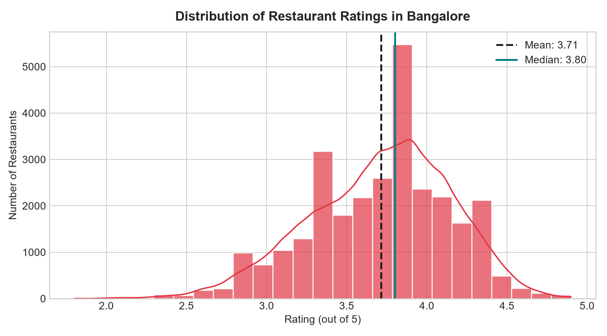
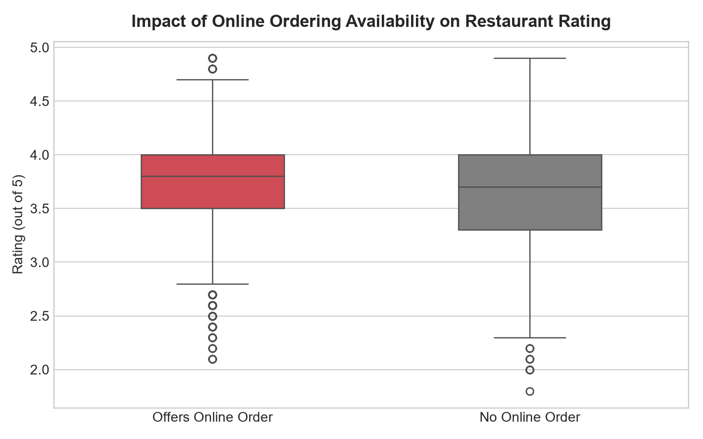
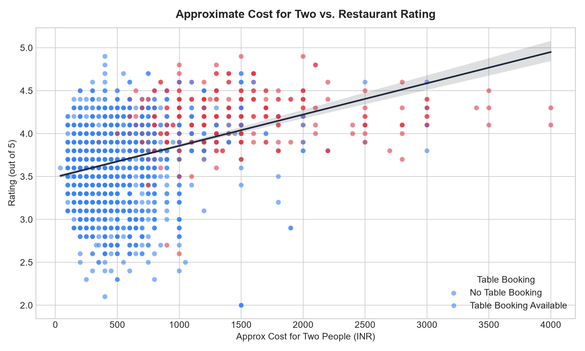
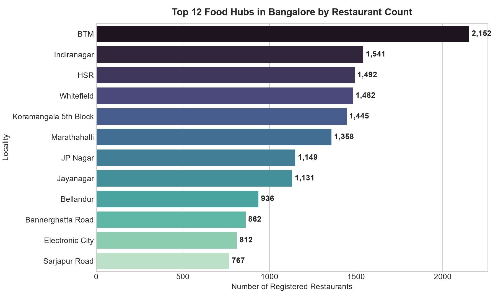
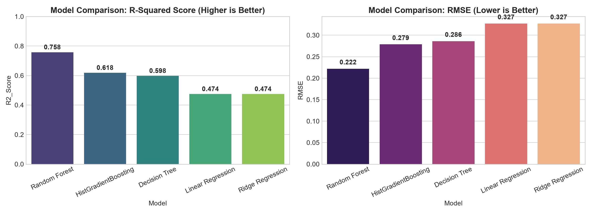
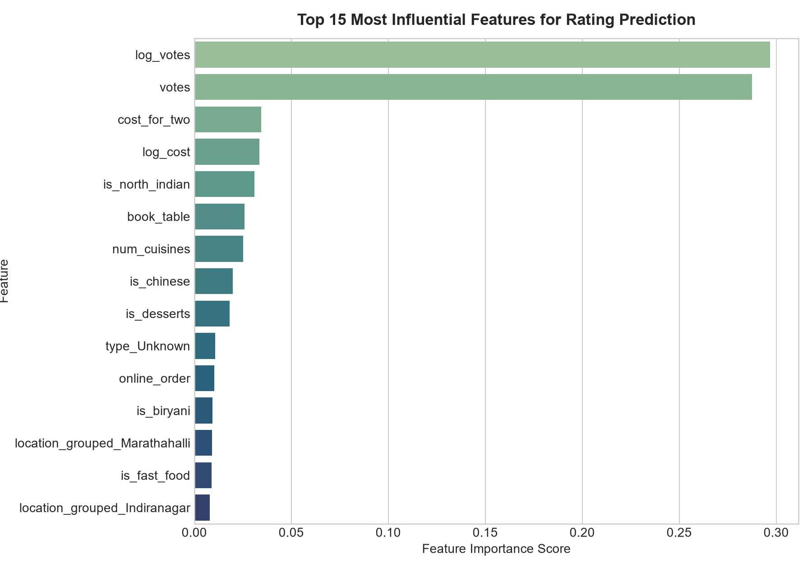

# 🍽️ Zomato Bangalore Restaurants: End-to-End Data Science & Rating Prediction

[](https://www.python.org/downloads/)
[](https://scikit-learn.org/)
[](https://opensource.org/licenses/MIT)

An end-to-end Machine Learning and Data Science project examining Bangalore's dining market through **79,000+ restaurant records** on Zomato. This project includes dirty data sanitization, comprehensive exploratory data analysis, feature engineering of multi-cuisine attributes and geospatial hubs, model benchmarking across five candidate regressors, and an inference engine for restaurant rating prediction.

---

## 📌 Executive Summary & Key Findings

1. **Review Momentum Over Mere Aesthetics:** Customer vote volume (`log_votes` and `votes`) is the single strongest determinant of restaurant rating, contributing over **58% of feature importance**. Active customer review generation correlates with operational longevity and trust.
2. **The Delivery Premium:** Outlets supporting **Zomato Online Ordering** consistently outperform offline-only competitors by an average of **+0.25 to +0.30 stars** in median customer satisfaction.
3. **Dining Tiering:** Table reservation functionality serves as a decisive proxy for fine-dining service standards; venues with table booking maintain a median rating of **4.1/5.0**, versus **3.6/5.0** for standard walk-ins.
4. **Culinary Capitals:** **BTM Layout**, **Koramangala 5th Block**, and **HSR Layout** form the highest density restaurant clusters in Bangalore, with North Indian, Chinese, and Continental reigning as the most widespread cuisines.

---

## 📊 Exploratory Visualizations

### 1. Market Distribution & Ordering Channel Impact
| Rating Distribution | Online Ordering vs. Customer Rating |
| :---: | :---: |
|  |  |

### 2. Pricing Dynamics & Geographic Density
| Cost for Two vs Rating | Top Food Hubs in Bangalore |
| :---: | :---: |
|  |  |

### 3. Model Benchmark & Feature Importance
| Model Comparison ($R^2$ & RMSE) | Feature Importance |
| :---: | :---: |
|  |  |

---

## 🤖 Machine Learning Model Evaluation

We benchmarked 5 distinct model families on an 80/20 train-test split (23,320 training samples, 5,831 test samples) with 76 engineered features:

| Model Architecture | $R^2$ Score (Test) | RMSE | MAE | Status |
| :--- | :---: | :---: | :---: | :---: |
| **Random Forest Regressor** | **0.7578** | **0.2221** | **0.1515** | 🏆 **Production Champion** |
| **HistGradientBoosting** | 0.6184 | 0.2787 | 0.1965 | Runner-up |
| **Decision Tree Regressor** | 0.5977 | 0.2862 | 0.1899 | Baseline Tree |
| **Ridge Regression** | 0.4745 | 0.3271 | 0.2358 | Regularized Linear |
| **Linear Regression** | 0.4745 | 0.3271 | 0.2358 | Baseline Linear |

The **Random Forest Regressor** demonstrated superior non-linear capture, explaining **75.78% of rating variance** with a minimal root mean squared error of **0.222**.

---

## 📁 Repository Structure

```text
Zomato-Data-Science-Project/
├── artifacts/
│   ├── models/
│   │   └── zomato_rating_model.joblib     # Serialized production model bundle
│   ├── feature_importance.csv             # Full feature weights table
│   └── model_comparison.csv               # Benchmark metrics across models
├── data/
│   ├── processed/
│   │   └── cleaned_zomato.csv             # Sanitized 29,151 unique venue records
│   └── raw/
│       └── zomato.csv                     # Raw Kaggle Bangalore dataset
├── notebooks/
│   └── zomato_eda_and_rating_prediction.ipynb # Interactive Jupyter Notebook
├── reports/
│   └── figures/                           # 7 high-resolution publication charts
├── src/
│   ├── __init__.py
│   ├── data_cleaning.py                   # Parsing rates, currency, nulls
│   ├── feature_engineering.py             # Geospatial binning, cuisine encoding
│   ├── model_training.py                  # End-to-end training pipeline
│   ├── predict.py                         # Single-venue rating inference
│   └── visualization.py                   # Plotting routines
├── pyproject.toml
├── requirements.txt
├── .gitignore
└── README.md
```

---

## 🚀 Quick Start Guide

### 1. Clone & Set Up Environment
```bash
git clone https://github.com/naveenyenuganti30-cell/Zomato-Data-Science-Project.git
cd Zomato-Data-Science-Project

python -m venv .venv
# Windows:
.\.venv\Scripts\activate
# Linux/macOS:
# source .venv/bin/activate

pip install -r requirements.txt
```

### 2. Run Training Pipeline & Recreate Figures
```bash
python -m src.model_training
```

### 3. Run Rating Prediction
```bash
python src/predict.py
```

Example Python usage:
```python
from src.predict import predict_rating

restaurant = {
    "location": "Koramangala 5th Block",
    "rest_type": "Casual Dining",
    "cost_for_two": 900,
    "votes": 450,
    "online_order": True,
    "book_table": True,
    "cuisines": ["Continental", "Italian", "North Indian"]
}

rating = predict_rating(restaurant)
print(f"Predicted Zomato Rating: {rating} / 5.0")
# Output: Predicted Zomato Rating: 4.16 / 5.0
```

---

## 👤 Author
**Yenuganti Naveen**  
- GitHub: [@naveenyenuganti30-cell](https://github.com/naveenyenuganti30-cell)  
- Email: [naveenyenuganti30@gmail.com](mailto:naveenyenuganti30@gmail.com)
